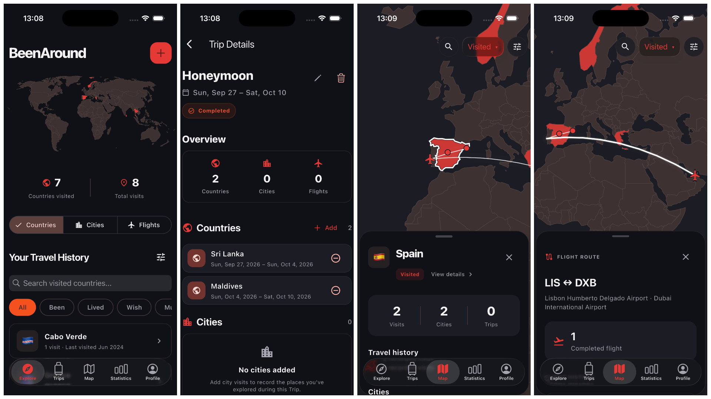

# BeenAround

**Your travels. Your history. Your world.**

BeenAround is an open-source, self-hosted travel tracking application for recording, organizing, and visualizing your travel history.

Inspired by applications like [Been](https://been.travel/) and [Flighty](https://flighty.com/), BeenAround brings together destination tracking, flight history, trips, and interactive maps in a single application, with its own features, design, and approach to managing travel memories.

The goal is simple: **keep track of everywhere you've been, while keeping your travel history under your control.**

> [!NOTE]
> BeenAround is under active development and is not yet production-ready.

## Screenshots

  

## Features

- **Explore:** Track visited countries and cities, previous residences, flights, and destinations you want to visit.
- **Trips:** Organize destinations, visits, and flights into journeys while keeping travel records independent.
- **Map:** Visualize visited countries, cities, airports, and flight routes on an interactive world map.
- **Statistics (planned):** Explore geographical coverage, travel patterns, and aviation statistics.
- **Profile (planned):** Manage your account, preferences, privacy, and personal data.

BeenAround is designed for multiple users, with individual travel histories and privacy by default.

## Tech Stack

**Frontend:** Flutter, Dart, flutter_bloc, Dio, go_router, MapLibre.

**UI:** Material 3 with custom components, iOS-inspired interactions, glass effects, and adaptive layouts. Dark Mode first, with Light Mode support.

**Backend:** Python, FastAPI, SQLAlchemy 2, Pydantic, Alembic, SQLite.

**Testing & Quality:** pytest, Ruff, Flutter tests, and static analysis.

The application follows a feature-oriented architecture inspired by Clean Architecture principles, emphasizing maintainability, separation of responsibilities, and explicit domain rules.

## Development Status

The core travel-tracking features, including Explore, Trips, Flights, and the interactive Map, are implemented.

Current development priorities include:

- Statistics and Profile.
- Docker and Docker Compose deployment.
- Security hardening and production readiness.
- Data import/export and administration.
- Documentation and broader cross-platform testing.

Additional capabilities, including shared Trips, advanced statistics, and external integrations, may be introduced in future releases.

## Getting Started

BeenAround is being developed with self-hosting as a primary goal.

A reproducible Docker Compose deployment, configuration instructions, and backup procedures are planned for a future milestone.

Until then, the application is intended primarily for development and testing.

**Production installation instructions will be added when the deployment process is ready.**

## About This Project

BeenAround is both a personal application and a software engineering learning project.

I started it to build a travel tracker that fits my needs while applying software architecture and design principles I studied during my Master's degree but have had fewer opportunities to use extensively in my professional work.

It is also an opportunity to strengthen my experience with Python, Flutter, and Dart while gaining practical experience in full-stack development, testing, and self-hosting.

### AI-Assisted Development

BeenAround is developed with the assistance of AI tools.

**The project's vision, architecture, feature requirements, design direction, and technical decisions are driven by me.** AI is used as a collaborative tool for implementation, code reviews, debugging, documentation, and discussing alternative approaches.

Suggestions are reviewed, discussed, and adapted rather than accepted blindly. My goal is not simply to build a working application, but to understand the decisions behind it and continuously improve my software engineering skills.

## Documentation

Technical documentation is being developed in the [`docs/`](docs/) directory, covering application features, architecture, domain models, API design, security, and deployment.

It will also include architecture decisions, workflows, and technical diagrams.

## Contributing

BeenAround is currently a personal project under active development, but contributions, suggestions, and feedback are welcome.

If you find a bug, have an idea for an improvement, or would like to contribute, feel free to open an issue or start a discussion.

For larger changes, please open an issue first to discuss the proposed approach and ensure it aligns with the project's architecture and direction.

Contribution guidelines will be added as the project matures.

## Acknowledgements

BeenAround draws inspiration from several existing applications and benefits from open geographic and aviation data.

**Application inspiration:**
- [Been](https://been.travel/) — travel history and visited-country tracking.
- [Flighty](https://flighty.com/) — flight information and aviation tracking.

**Geographic and aviation data:**
- [OpenStreetMap](https://www.openstreetmap.org/)
- [Natural Earth](https://www.naturalearthdata.com/)
- [GeoNames](https://www.geonames.org/)
- [OurAirports](https://ourairports.com/)

BeenAround is an independent project and is not affiliated with or endorsed by the applications mentioned above.

Data and mapping services remain subject to their respective licensing and attribution requirements.

## License

BeenAround is licensed under the **MIT License**.

See the [LICENSE](LICENSE) file for details.